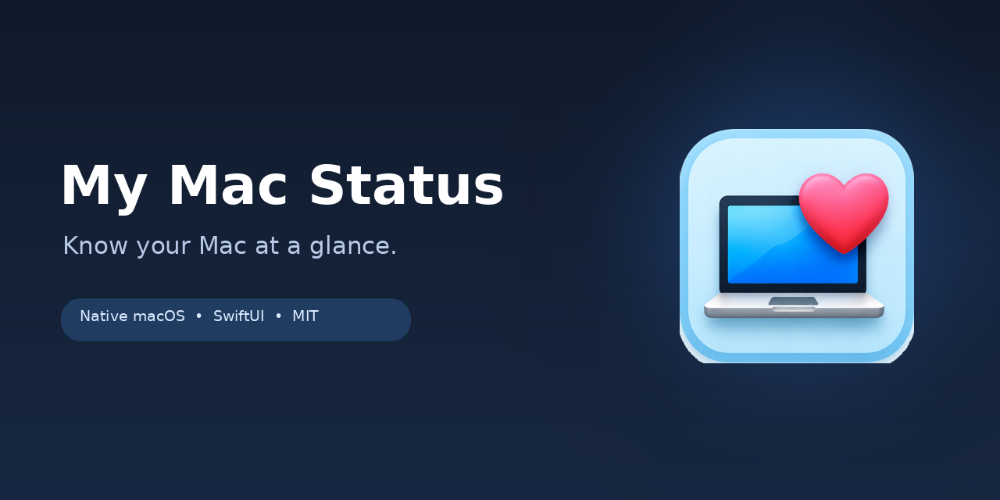
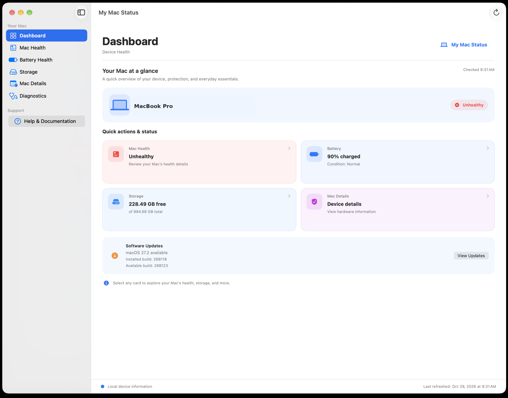
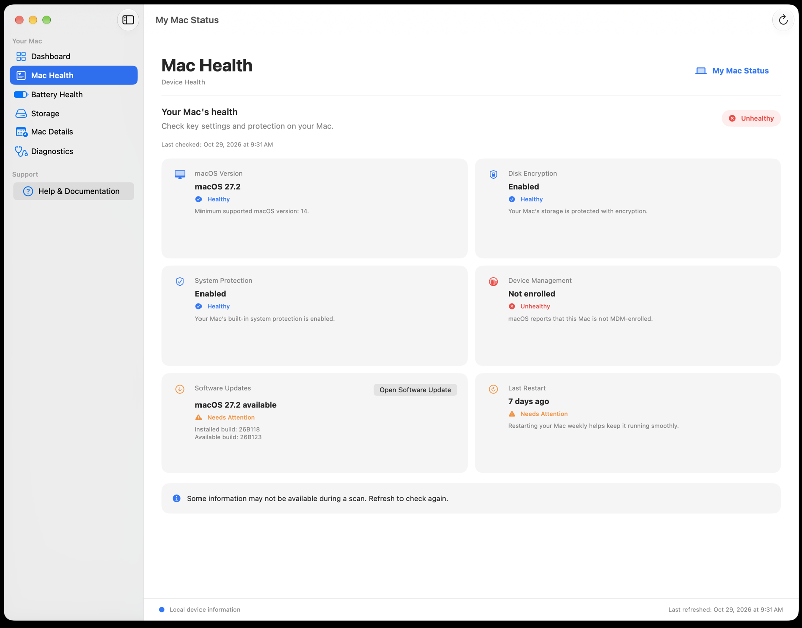
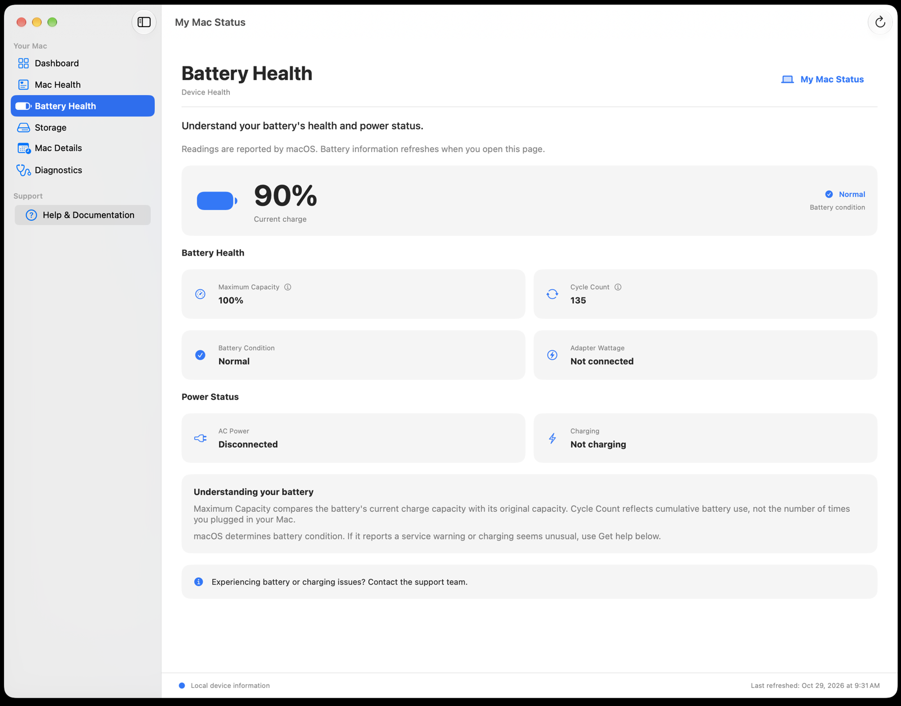
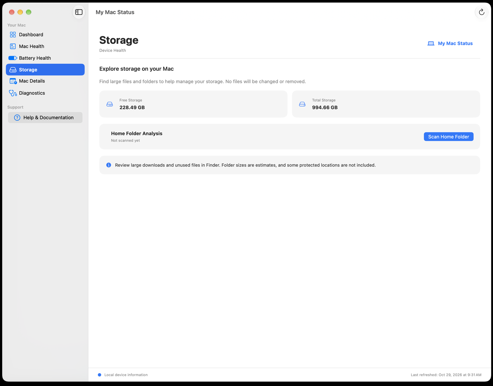
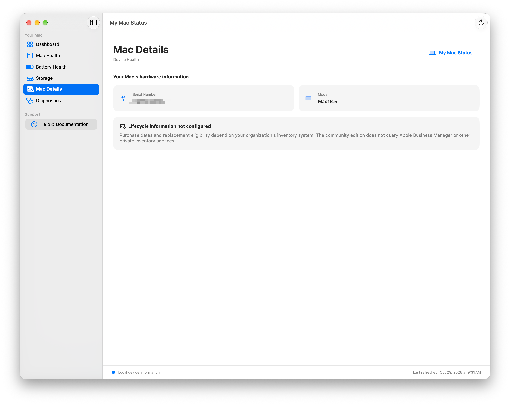
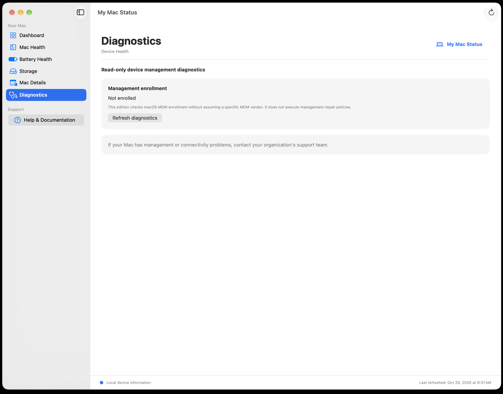

<div align="center">



**Know your Mac at a glance.**

A friendly, native macOS app that makes it easy to check your Mac’s health, battery, storage, and hardware information—all in one place.

   [](LICENSE)

</div>

## Releases and development

| Edition | Branch | Status | External MDM integrations |
| --- | --- | --- | --- |
| **Community Edition v1.0.0** | `main` | Stable baseline | **Not included** |
| **Community Edition v1.1.1** | [`development/v1.1.1-managed-integrations`](https://github.com/prettyflyjewishguy/My-Mac-Status/tree/development/v1.1.1-managed-integrations) | Development candidate | **Being adapted and tested** |

**What works on `main`:** The standalone Community Edition provides local Mac health, battery, storage, hardware information, and read-only management diagnostics. It does **not** authenticate to Jamf Pro, Apple Business Manager, Iru/Kandji, or Microsoft Intune to retrieve inventory or lifecycle records. No MDM API credentials or external gateway are needed for its local features.

**Production heritage:** The separate internal enterprise edition deployed at my organization has working **Jamf Pro** and **Apple Business Manager (ABM)** integrations for managed inventory and device lifecycle / estimated replacement information. This is production experience with the *internal implementation*, **not** a claim that those integrations ship in the public `main` branch.

**What's next:** The v1.1.1 development branch is adapting that proven functionality into an optional, organization-neutral **gateway architecture**. Work includes Jamf Pro and ABM integration, with Iru/Kandji and Microsoft Intune support being developed. The public gateway, cross-provider adapters, packaging, and end-to-end operation still require their own validation. Local app features will continue to work without a gateway.

> **Release policy:** `main` remains the stable Community Edition. Development code will not be merged or described as production-ready until it has been built, tested, and approved.

## Take a look

### Dashboard
Get a quick overview of your Mac and the things that might need attention.



<table>
<tr><td width="50%"><strong>Mac Health</strong><br></td><td width="50%"><strong>Battery Health</strong><br></td></tr>
<tr><td><strong>Storage</strong><br></td><td><strong>Mac Details</strong><br></td></tr>
<tr><td><strong>Diagnostics</strong><br></td><td><strong>Made for macOS</strong><br>Native SwiftUI design with a familiar sidebar, straightforward status indicators, and read-only checks.</td></tr>
</table>

## What it does

- **Dashboard:** See device health, battery charge, available storage, and software-update status at a glance.
- **Mac Health:** Review FileVault encryption, system protection, updates, uptime, and device enrollment.
- **Battery Health:** Check charge, maximum capacity, cycle count, and charging information.
- **Storage:** See available space and scan your home folder for large files and folders. Nothing is deleted.
- **Mac Details:** View local hardware and model information.
- **Diagnostics:** Check MDM enrollment status without making changes to your Mac.

## Get started

**Requirements:** An Apple silicon Mac running macOS 14 or later, plus Xcode Command Line Tools and the macOS SDK to build from source.

This repository provides **source code and a local build script**. The build creates an ad-hoc-signed app and an unsigned installer; it is not a notarized consumer download.

1. Download or clone this repository on your Mac.
2. Open Terminal in the repository folder.
3. Run:

   ```zsh
   zsh Scripts/build_on_mac.zsh
   ```

4. Find the generated application and installer in `output/`.

For local build validation, run `zsh Scripts/validate_on_mac.zsh`.

## Make it yours

My Mac Status supports optional organization branding, including a custom icon, logo, name, and support details. See [Branding & customization](docs/BRANDING.md) for configuration examples.

## Privacy first

My Mac Status reads device information locally. It does not send reports to a remote service, install privileged helpers, or change your device-management configuration. A home-folder storage scan may request macOS privacy permissions; only grant access you are comfortable with. Learn more in [SECURITY.md](SECURITY.md).

## Contributing

Ideas, bug reports, and improvements are welcome! See [CONTRIBUTING.md](CONTRIBUTING.md) before submitting a pull request.

## License

Released under the [MIT License](LICENSE). © 2026 Ethan Besbris.
