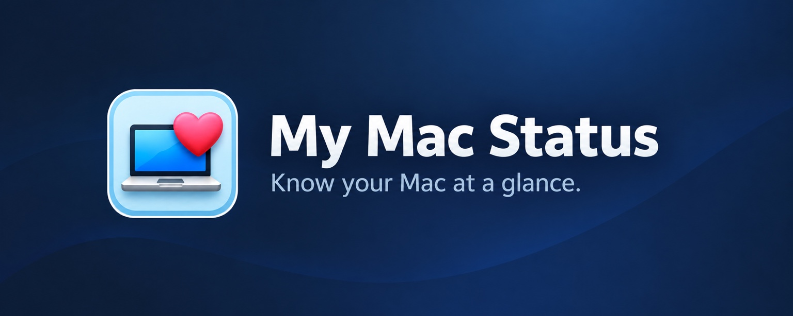

# My Mac Status — Community Edition 2.0

Native macOS utility for understanding Mac health, security, battery, storage, hardware, update readiness, and estimated replacement lifecycle. **macOS 14 or newer; Apple silicon build target.** Open-source under the MIT license.

## Features
- Overview dashboard, Device Insights, Health & Security, Battery, Storage, Mac Details and read-only Diagnostics.
- macOS update intelligence and explicit on-demand update checks (no automatic OS installation).
- Battery condition, capacity, cycle count, power status, and home-folder storage analysis.
- Estimated replacement planning using available device dates and configurable lifecycle; estimates are not purchase approvals or warranty guarantees.
- Optional Jamf Pro, Iru/Kandji, and Apple Business Manager connections; the app works without them. Intune is not implemented.
- MDM-managed preferences for connection endpoints, sidebar restrictions, organization logos and brand colors, including live theme reconciliation.
- Light/dark appearance and native title bar preserved; semantic health colors remain meaningful.

## Screenshots

Screenshots from My Mac Status CE 2.0 on macOS. The application supports light and dark appearances; organization branding and accent colors may vary with MDM configuration.

### Overview dashboard

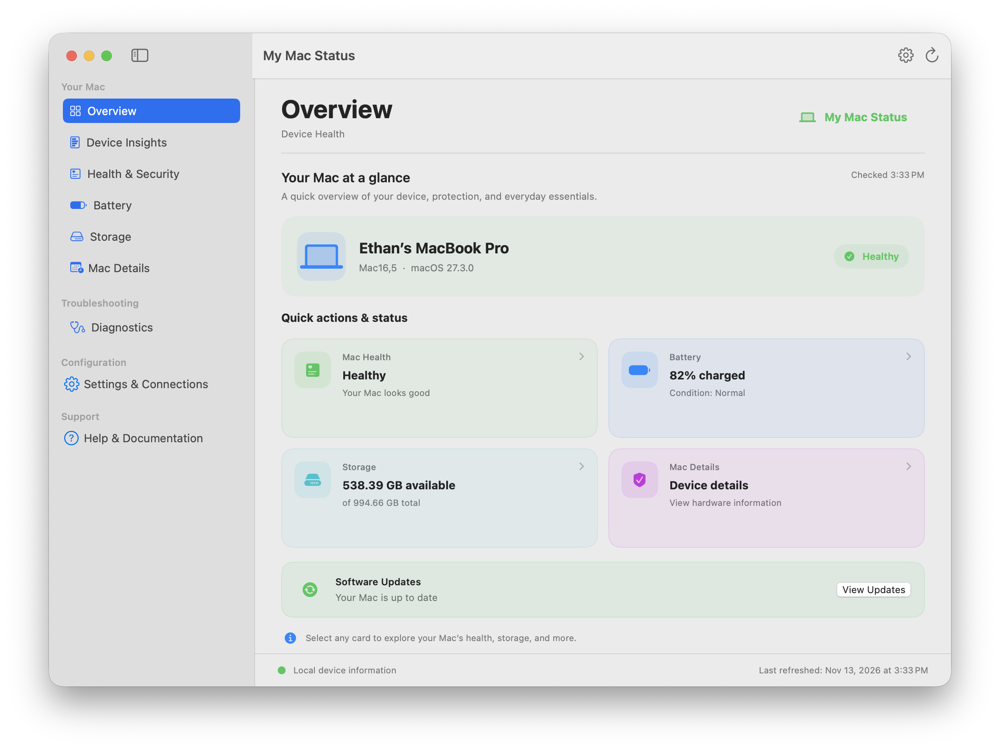

### Health & Security with macOS Update Intelligence

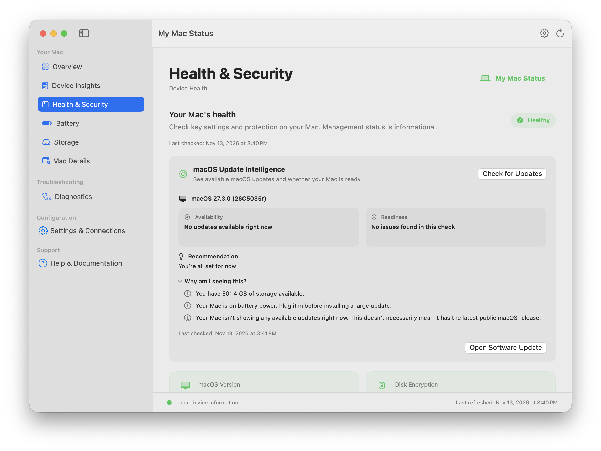

### Optional provider connections

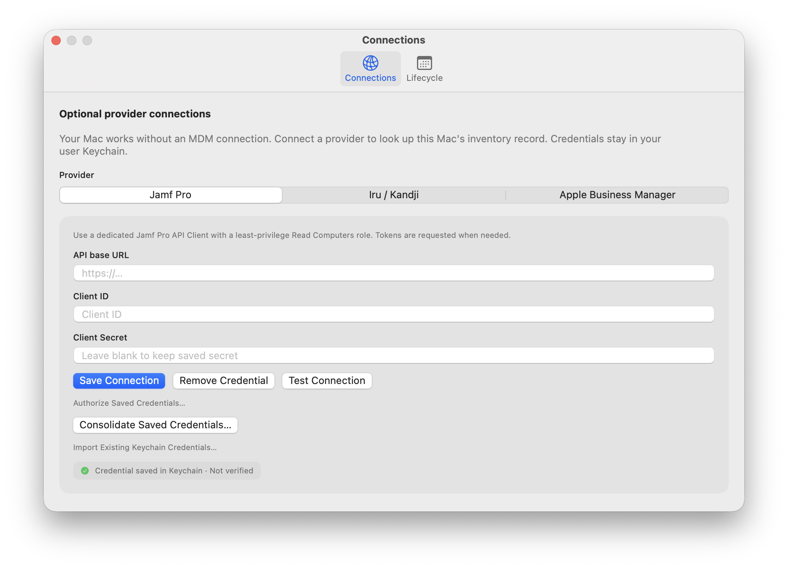

### Help — Getting Started

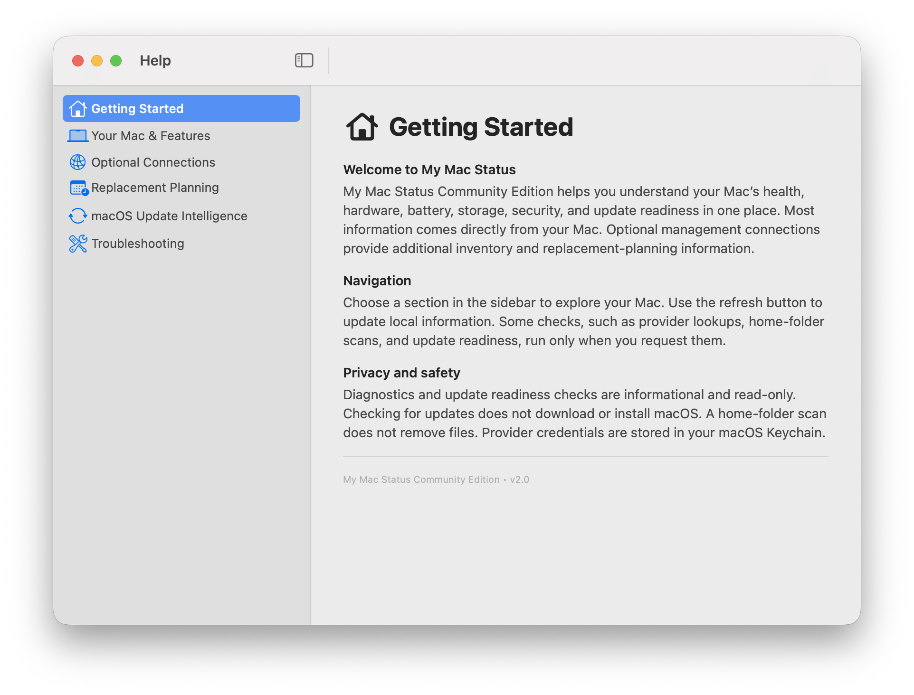

### Help — macOS Update Intelligence

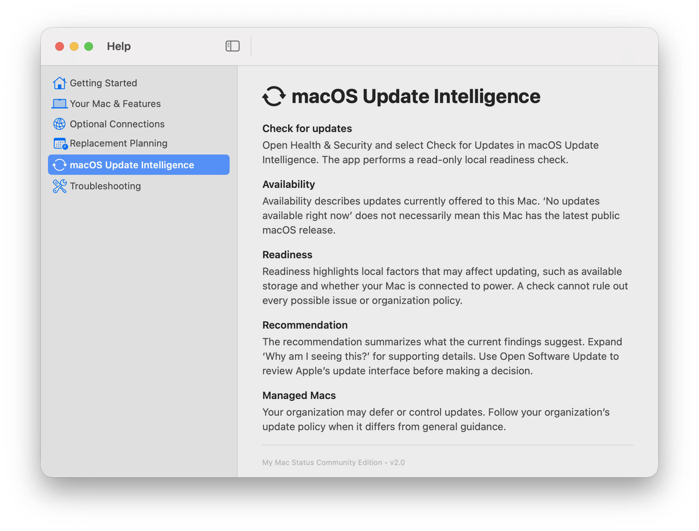

### Help — Optional Connections

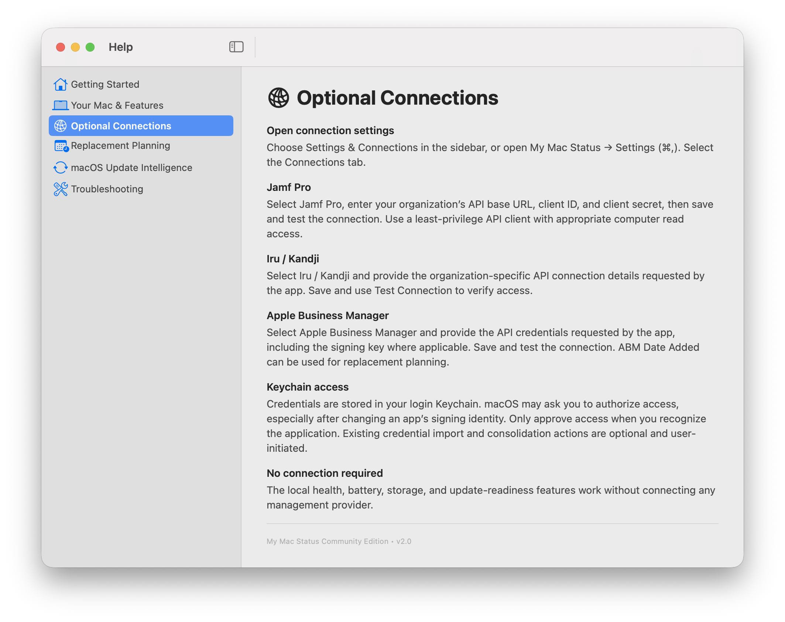

### Battery

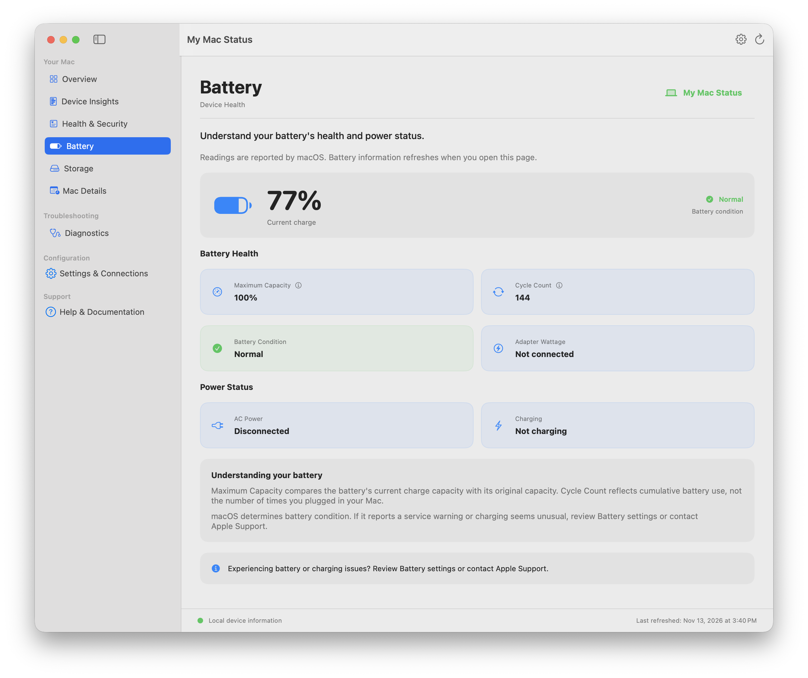

### Storage

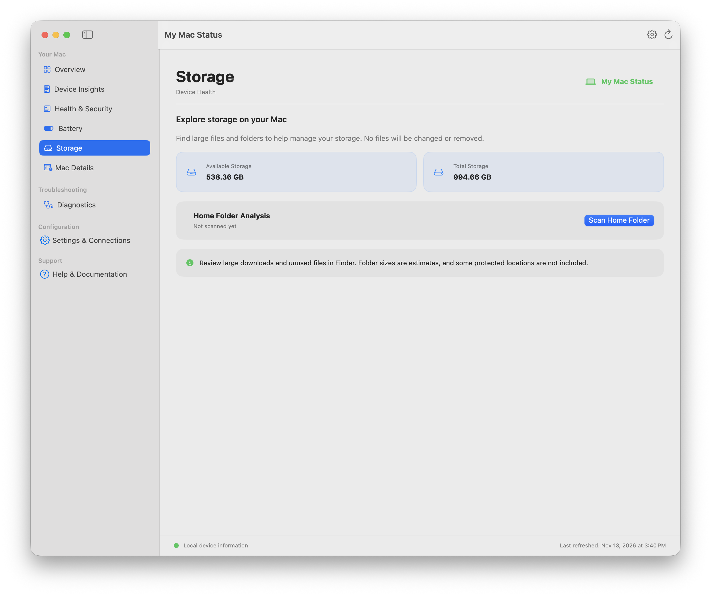

### Health & Security — status cards

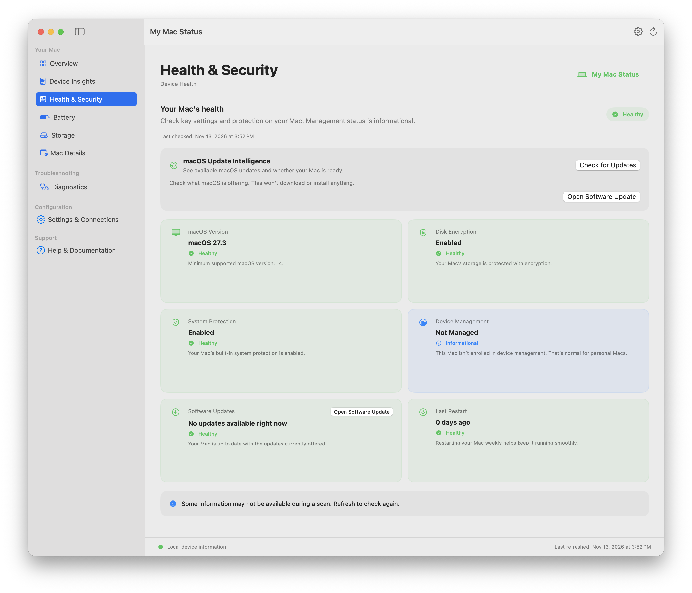

### Device Insights

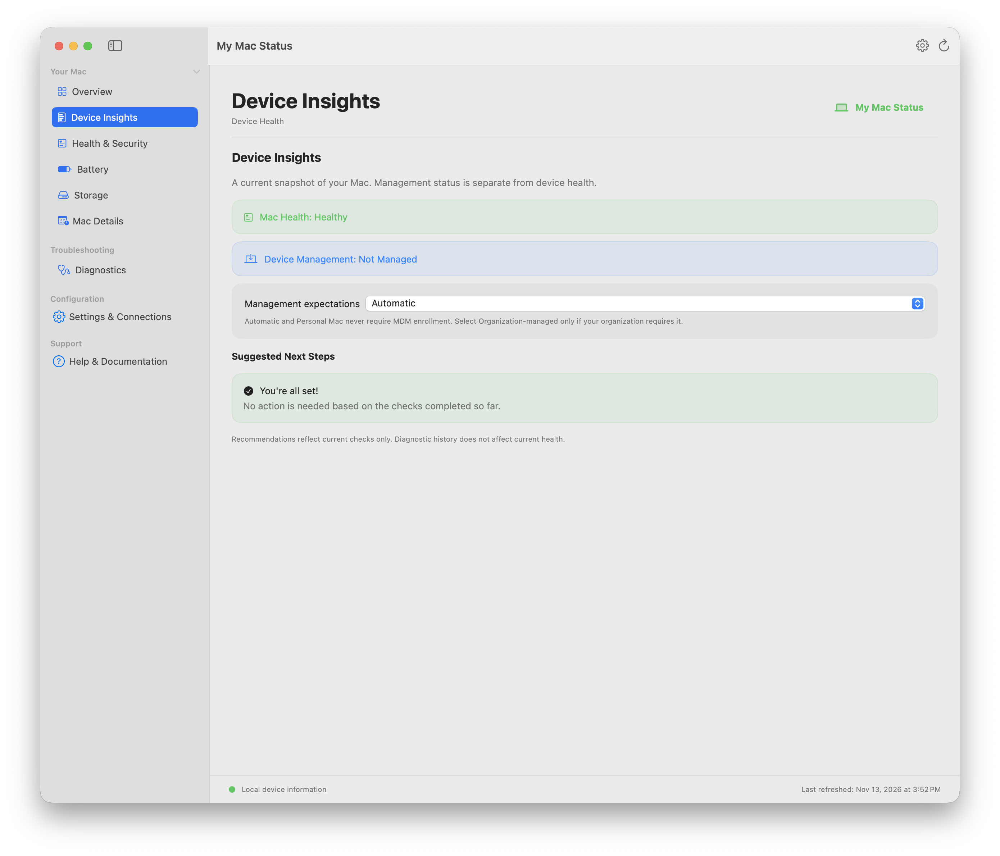

### Diagnostics

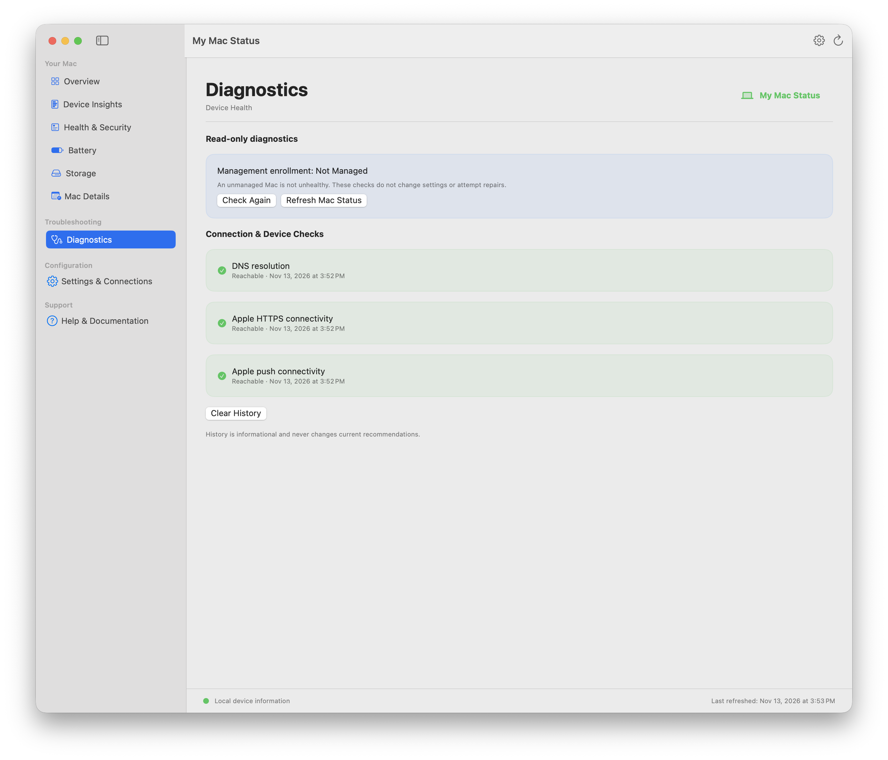

## Build
On a Mac with Xcode command-line tools and the macOS SDK:

```zsh
zsh Scripts/build_on_mac.zsh
zsh Scripts/validate_on_mac.zsh
```

Build metadata: **2.0 (2000)**; bundle identifier **`com.prettyfly.mymacstatus`**. Build outputs and signing requirements are determined by the included scripts. The source archive is **not** a signed or notarized installer.

## Managed deployment
Read [ADMIN_DEPLOYMENT.md](ADMIN_DEPLOYMENT.md) before distributing. A complete, editable sample profile is at [`ManagedDeployment/v2.0-Consolidated-Branding-Example.mobileconfig`](ManagedDeployment/v2.0-Consolidated-Branding-Example.mobileconfig). Replace all example image URLs. Never put API tokens or passwords in configuration profiles.

## Privacy and limitations
Local diagnostics are informational/read-only; home-folder scans do not remove files. Optional provider requests require administrator-supplied access and network connectivity. Profile updates and credential migration should be tested on real Macs before fleet deployment. See [RELEASE_NOTES_v2.0.md](RELEASE_NOTES_v2.0.md) and [GA_VALIDATION_CHECKLIST.md](GA_VALIDATION_CHECKLIST.md).

MIT License. © 2026 Ethan Besbris.
